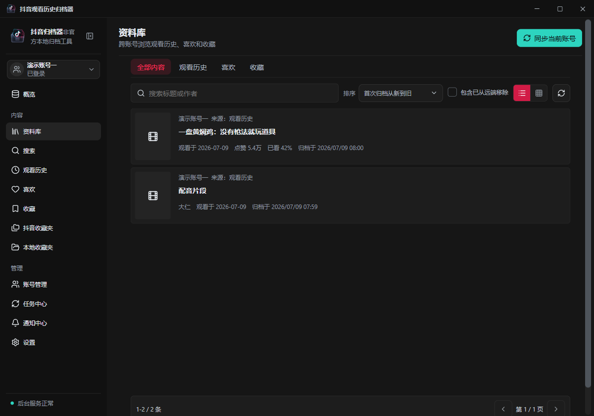

<p align="center">
  
</p>

<h1 align="center">Emily</h1>

<p align="center"><strong>把抖音观看历史、喜欢和收藏, 整理到自己的电脑.</strong></p>
<p align="center">Windows x64 | 本地 SQLite | 多账号归档 | GPL-3.0-only</p>

<p align="center">
  <a href="#开始使用">开始使用</a> ·
  <a href="#首次使用">首次使用</a> ·
  <a href="#数据与隐私">数据与隐私</a> ·
  <a href="#开发与验证">开发与验证</a>
</p>

Emily 是一个非官方 Windows 桌面归档工具. 它通过系统 Edge 或 Chrome 访问本人账号可见的抖音内容, 将归档记录保存到本机, 方便搜索、整理和回顾.



*界面取自当前前端的浏览器演示模式, 使用内置演示账号与样例记录. 不代表真实账号同步验收结果; 点击图片可查看原尺寸.*

## 可以做什么

| 你想做的事 | Emily 提供的能力 |
| --- | --- |
| 找回浏览过的内容 | 归档观看历史, 按标题或作者搜索, 浏览观看时间等记录 |
| 整理喜欢和收藏 | 查看喜欢、默认收藏与远端收藏夹, 使用本地收藏夹整理内容 |
| 管理多个账号 | 独立登录资料、账号切换、跨账号资料库和同步设置 |
| 回顾自己的记录 | 概览统计、趋势展示和年度回顾 |
| 保存可访问的资源 | 从观看历史手动创建视频、图文或实况资源下载任务 |
| 管理长期归档 | 手动或定时同步, 任务与通知中心, 备份、恢复和去重合并 |

同步归档记录与下载媒体是两个操作. 同步不会自动下载全部视频; 下载需要手动创建任务, 并受内容可访问性限制.

## 开始使用

**当前状态: 公开源码准备阶段, 尚未发布与最新源码对应的稳定安装包.** 旧测试安装包不包含本轮全部依赖修复, 请勿将其当作当前版本的发布产物.

运行环境:

- Windows x64, 已安装 Microsoft Edge 或 Google Chrome.
- Microsoft Edge WebView2 Runtime. 安装包会在需要时调用运行时引导安装器, 此过程可能需要联网.
- 登录、同步和下载需要网络; 已归档记录可在本地查看.

### 从源码构建

在仓库根目录执行. 需要 Rust 1.95 或更新版本、Cargo、Visual Studio C++ Build Tools 和 Windows SDK. 当前回归使用 Rust 1.96.1 验证.

```powershell
cargo install tauri-cli --version 2.11.4 --locked
cargo test --manifest-path src-tauri/Cargo.toml --locked -- --test-threads=1
cargo tauri build
```

NSIS 安装包输出到 `src-tauri/target/release/bundle/nsis/`.

正式构建直接验证并使用 Git 中提交的 `dist/`. 使用这些已有前端产物时, 构建和安装后的应用不依赖 Node、npm、Playwright 或内置 Chromium. 修改前端后, 必须按下文重新构建并一同提交 `dist/` 和 manifest.

## 首次使用

1. 安装并启动应用, 跟随首次设置向导选择浏览器和登录账号. 也可以跳过登录, 稍后在账号管理中添加.
2. 确认同步来源、范围与周期. 应用为各账号使用独立的浏览器 profile.
3. 确认数据目录和桌面选项. 以后切换数据位置时, 使用应用内的数据目录迁移功能.
4. 完成向导后, 打开观看历史、喜欢或收藏, 手动同步当前来源, 再到资料库查看和搜索本地记录.

初次同步建议使用较小范围, 检查任务中心的结果后再扩大. 浏览器登录失效、平台验证或页面变化可能中断采集, 请先在账号管理中检查状态.

## 数据与隐私

- 归档数据库、设置和登录资料保存在本机受管目录, 不写入应用安装目录.
- 默认数据根位于 `%APPDATA%\lifearchive.douyin-history-archive\Data`, 也可以在应用内选择其他位置.
- **备份未加密.** `.emily-backup` 包含数据库与可迁移设置, 不包含浏览器登录 profile、封面缓存、日志或下载媒体. 数据库本身仍可能包含账号资料、观看记录和内容链接.
- 备份不恢复登录状态, 更换电脑后需要重新登录. 不要将登录 profile、Cookie、数据库或未脱敏诊断上传到 Issue.

详细说明见 [数据与隐私](docs/privacy.md), 包括网络访问、目录分工、备份范围和反馈前的脱敏要求.

## 开发与验证

前端使用 Svelte 5、Vite 和 TypeScript; 桌面端使用 Tauri 2、Rust 和 SQLite. 浏览器采集由 Rust 原生 CDP 客户端连接系统浏览器完成.

前端开发和重建需要 **Node 24.15.0 + npm 11.12.1**, manifest 会校验工具版本. 在仓库根目录执行:

```powershell
npm ci
npm test
npm run typecheck
npm run app:build
npm run app:dev
```

`npm run app:dev` 是前端浏览器演示, 使用模拟 API 和内置样例数据, 不提供真实登录、采集或归档持久化. `npm run app:build` 后生成的 `dist/` 才供桌面端使用.

<details>
<summary>原生系统浏览器夹具</summary>

这些显式忽略的测试需要本机系统浏览器. 常规 Cargo 测试不会自动运行它们; 真实登录验收也不能由这些夹具替代.

```powershell
cargo test --manifest-path src-tauri/Cargo.toml --locked --test cdp_system_browser -- --ignored --test-threads=1
$env:EMILY_TEST_BROWSER="chrome"
cargo test --manifest-path src-tauri/Cargo.toml --locked --test cdp_system_browser -- --ignored --test-threads=1
Remove-Item Env:EMILY_TEST_BROWSER
```

部分夹具还要求能访问抖音首页. 仅在准备好相应环境时运行.

</details>

## 已知限制

- 目前只面向 Windows x64. 归档范围受平台当前提供的数据、登录状态和页面结构影响, 不保证补回所有过去记录或已不可访问的内容.
- 默认收藏、命名收藏夹发现和指定收藏夹同步已通过自动化夹具, 仍待真实登录账号验收.
- 自动更新需要构建时配置正式 HTTPS 更新地址和签名公钥; 缺少配置时不可用. 新版更新器尚未完成真实签名安装流程验收.
- 已知有补丁的依赖问题已升级处理. 开发链路仍有一个上游未修复的 `deepmerge` 低危问题, 详见 [依赖安全记录](docs/dependency-security.md).

发布安装包前还需要完成实页验收、安装与升级验证、对应源代码及完整原生依赖声明. 源码测试通过不等同于已经发布稳定安装包.

## 文档与反馈

- [数据与隐私](docs/privacy.md)
- [依赖安全记录](docs/dependency-security.md)
- [第三方声明与依赖清单](THIRD_PARTY_NOTICES.md)
- [原生运行时与打包设计](docs/superpowers/specs/2026-07-11-node-free-runtime-packaging-design.md)

反馈问题时, 请提供应用版本、Windows 和浏览器版本、操作步骤与脱敏后的错误信息. 账号登录信息和原始数据库不适合作为公开附件.

## 许可证与使用边界

Copyright (C) 2026 LifeArchiveProject.

除单独声明的第三方材料外, 本项目采用 [GPL-3.0-only](LICENSE), 即仅 GNU GPL 第 3 版. 软件按现状提供, 不作任何担保. 分发时须遵守许可证, 包括对应源代码与声明要求; 第三方材料保留各自授权, 见 [THIRD_PARTY_NOTICES.md](THIRD_PARTY_NOTICES.md).

本项目与抖音及其运营方无隶属或授权关系. 请仅归档和保存本人有权访问、下载或使用的内容, 遵守平台规则及相关权利要求. 项目的 GPL 授权不授予平台内容的版权或再分发权限.
