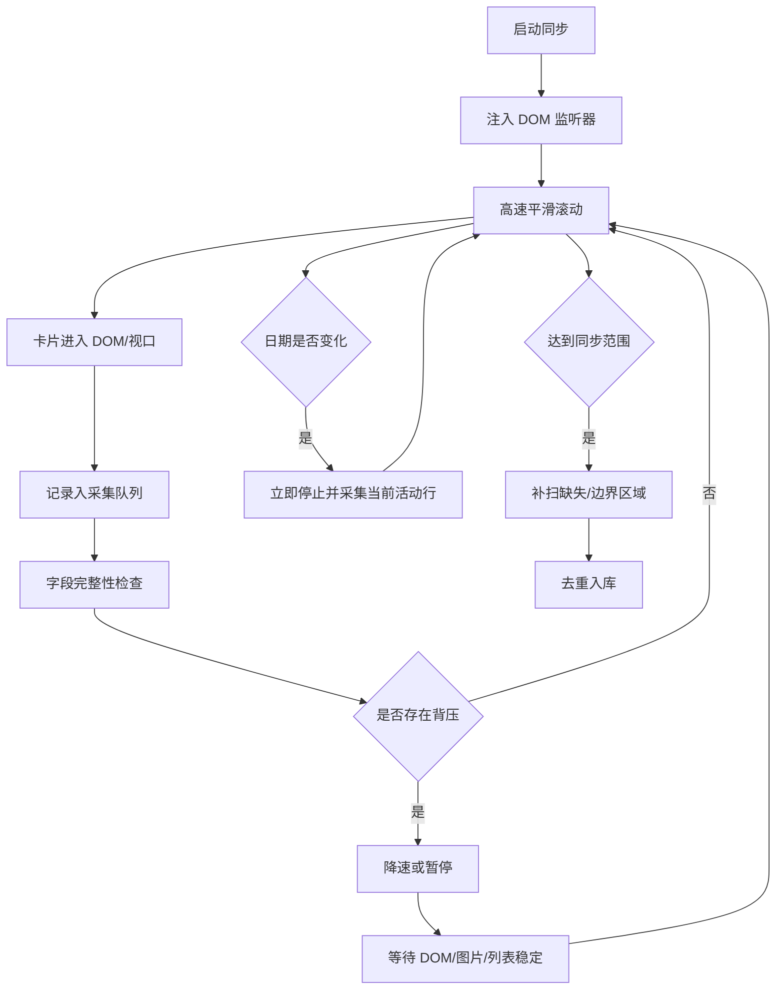

# 高速稳定采集方案

## 目标

在较高滚动速度下提升采集效率，同时尽量保证观看历史记录不漏采、日期归属稳定、字段完整度可控。

## 核心结论

不能依赖“高速滚动 + 固定间隔采样”来保证稳定。可靠方案应改为：

**高速滚动 + DOM 监听采集 + 背压控制 + 日期变化即停 + 补扫机制**。

## 问题背景

当前采集依赖页面可见区域采样。滚动速度过高时，会出现以下问题：

- 卡片进入视口时间过短，采样来不及覆盖。
- 抖音页面懒加载或虚拟列表导致 DOM 尚未完整挂载。
- 标题、封面、点赞量、观看进度等字段加载存在延迟。
- 日期标签跟随顶部活动行变化，高速下容易滞后或跳变。
- 到达加载底部时，页面还未加载下一批数据，可能误判稳定或结束。

## 设计原则

1. 滚动速度可以快，但采集必须有“背压”。
2. 记录采集不应只依赖定时快照，应监听 DOM 变化。
3. 日期边界是高风险区域，需要在日期变化时立即停止并复核。
4. 高速模式优先采全 URL、顺序、日期，再补字段。
5. 稳定性优先级高于全程无停顿。

## 推荐架构

## 核心机制

### 1. DOM 监听采集

在页面内注入 `MutationObserver`，监听观看历史列表下新增或更新的卡片节点。卡片一旦出现在 DOM 中，就立即提取：

- 视频 URL / aweme_id
- 标题
- 作者
- 封面 URL
- 点赞量
- 观看进度
- 当前页面日期标签
- 滚动位置
- 采集顺序

这样可以减少高速滚动时“卡片经过视口但没被采样”的问题。

### 2. IntersectionObserver 辅助

使用 `IntersectionObserver` 记录卡片进入/离开视口的时间点。这样可以判断哪些卡片真正经过了可见区域，并为日期归属提供参考。

### 3. 背压控制

当出现以下情况时，滚动自动降速或暂停：

- 新增卡片队列未处理完。
- 当前可见卡片字段缺失过多。
- 页面高度正在变化。
- 已接近当前加载底部。
- 可见卡片数量明显低于预期。
- 日期标签刚发生变化。
- 连续多次采样无新增记录。

背压解除后再恢复高速。

### 4. 日期变化即停

抖音日期不是按组展示，而是随顶部活动行变化。高速下日期边界最容易错。

策略：

- 普通区域使用高速滚动。
- 检测到日期标签变化时，立即停止当前连续滚动会话。
- 停止后先等待当前活动行 DOM/预览图就绪并完成采集。
- 记录变化前后的滚动位置。
- 必要时在边界附近补扫。
- 以顶部活动行、卡片位置、日期标签变化点共同判断日期归属。

### 5. 两阶段采集

第一阶段：高速扫描。

目标是快速抓取尽可能多的记录，重点保存 URL、顺序、滚动位置、粗略日期。

第二阶段：补扫修正。

针对以下区域低速补扫：

- 日期变化边界。
- 字段缺失较多的记录。
- 加载底部附近。
- 采样密度异常稀疏的区间。

## 高速模式建议参数

- 普通滚动速度：`3000-8000 px/s`
- 日期变化：立即停止并采集当前活动行
- 加载区等待：直到页面高度或卡片数量稳定
- 字段等待：优先等待 URL/标题，封面可延后
- 窗口布局：建议缩小到一行 3 个视频
- 浏览器模式：默认隐藏浏览器
- 媒体加载：阻止视频媒体，保留图片或封面 URL

## 成功标准

- 同一时间范围重复采集 2-3 次，记录数量差异很小。
- 日期分布基本一致。
- 页面顺序保持稳定递增。
- 日期边界附近无明显错归属。
- 高速模式采集数量显著高于当前 `8000 px/s` 的 63 条异常结果。
- 字段完整率可量化，例如标题/URL 接近 100%，作者/封面逐步提升。

## 风险

- 抖音 DOM 结构变化会影响监听器。
- 虚拟列表可能导致离屏节点被回收，需要及时缓存。
- 日期归属仍是最高风险点，需要日期变化即停和边界复扫。
- 过度阻止图片可能影响封面 URL 获取。
- 过高速度下浏览器主线程仍可能掉帧。

## 推荐实现顺序

1. 给采集日志增加停顿原因和采样密度指标。
2. 注入 `MutationObserver`，实现 DOM 新卡片即时入队。
3. 增加背压判断：队列未清空、列表加载中、字段缺失时暂停。
4. 增加日期变化检测和立即停止采集当前活动行。
5. 增加边界区域补扫。
6. 再开放 `8000 px/s` 以上的实验高速模式。
